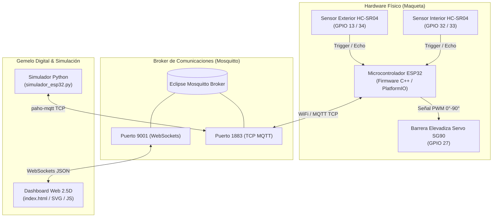
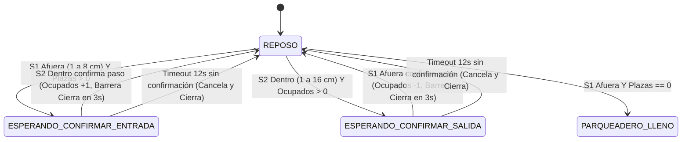
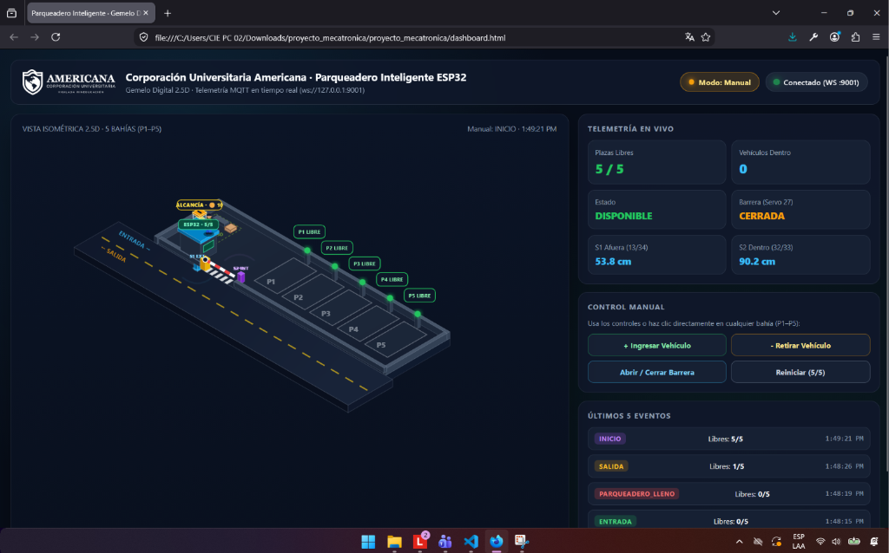
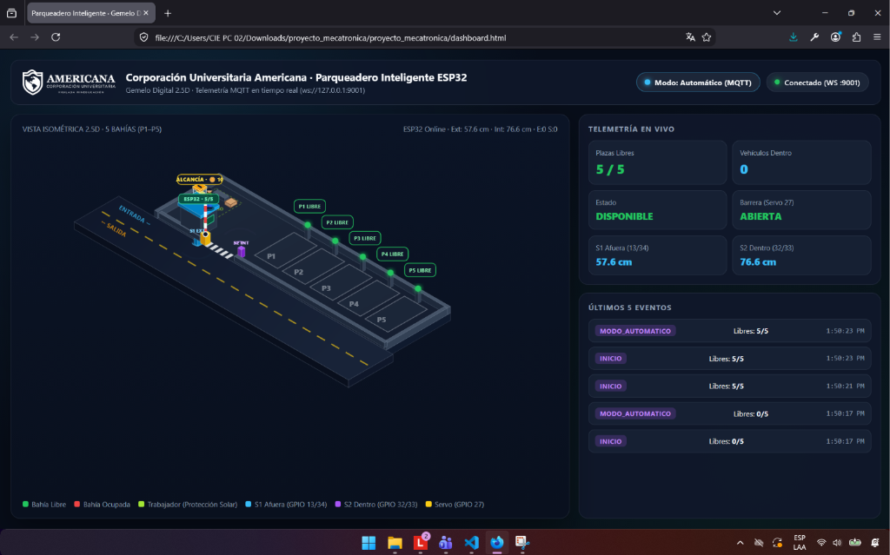
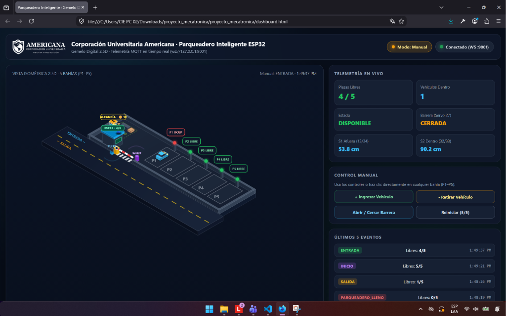
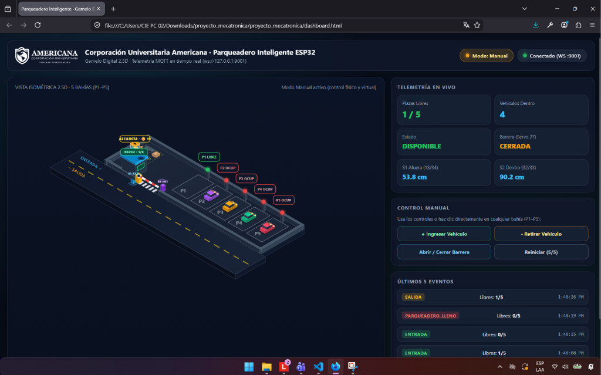
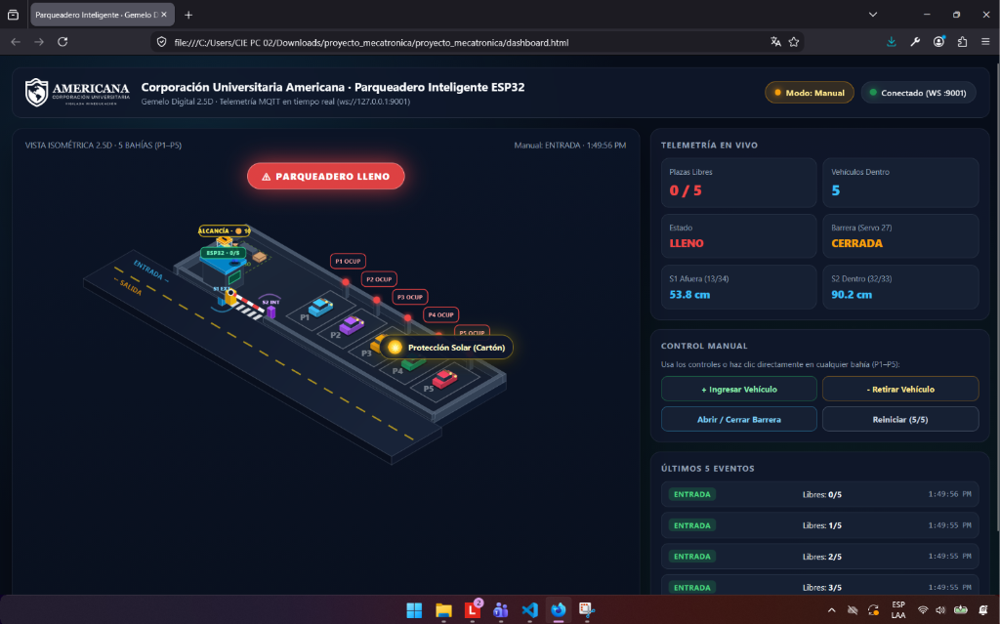

# Corporación Universitaria Americana
## Sistema de Parqueadero Inteligente ESP32
Yeimer Ortiz,
Sebastian De Luque,
Camilo Martinez,
Sebastian Martinez,
Martin castro.

<div align="center">


[](https://www.espressif.com/)
[](https://platformio.org/)
[](https://es.wikipedia.org/wiki/C%2B%2B)
[](https://mqtt.org/)
[](https://mosquitto.org/)
[](https://developer.mozilla.org/es/docs/Web/API/WebSockets_API)
[](https://python.org/)
[](https://pages.github.com/)


---

## Tabla de Contenidos
1. [Descripción General](#descripción-general)
2. [Cómo Ver el Gemelo Digital en Línea (GitHub Pages)](#como-ver-el-gemelo-digital-en-línea-github-pages)
3. [Arquitectura del Sistema](#arquitectura-del-sistema)
4. [Hardware y Conexiones (Pinout)](#hardware-y-conexiones-pinout)
5. [Bitácora de Desafíos, Errores y Soluciones](#bitácora-de-desafíos-errores-y-soluciones)
6. [Galería de Evidencias](#galería-de-evidencias)
7. [Tópicos MQTT y Telemetría](#tópicos-mqtt-y-telemetría)
8. [Estructura del Proyecto](#estructura-del-proyecto)
9. [Guía de Instalación y Ejecución](#guía-de-instalación-y-ejecución)
10. [Créditos](#créditos)

---

## Descripción General

Este proyecto consiste en un **Sistema Integral de Estacionamiento Inteligente Automatizado (Smart Parking IoT)** desarrollado como prototipo funcional para la carrera de Ingeniería Mecatrónica en la **Corporación Universitaria Americana**.

El sistema combina:
- **Capa Embebida (Hardware Físico):** Controlado por un microcontrolador **ESP32 DevKit v1**, con 2 sensores ultrasónicos HC-SR04 para detección direccional de vehículos (entrada y salida), y un servomotor SG90 que comanda físicamente la barrera elevadiza de acceso.
- **Capa de Red e IoT:** Protocolo **MQTT** con broker centralizado **Eclipse Mosquitto**, permitiendo comunicación de baja latencia con puerto nativo TCP (1883) y WebSockets (9001).
- **Gemelo Digital 2.5D (Dashboard Web Interactivo):** Desarrollado con gráficos vectoriales SVG isométricos, JavaScript modular y CSS3, permitiendo visualizar en tiempo real el aforo (5 bahías: P1 a P5), animaciones de flujo vehicular, telemetría de distancias en centímetros, estados de la barrera y control manual remoto.
- **Simulador en Python:** Script autónomo (`simulador_esp32.py`) basado en `paho-mqtt` que emula el comportamiento de la maqueta física para validación y desarrollo ágil.

---

### Enlace Oficial:
**[HAZ CLIC AQUÍ PARA ABRIR EL GEMELO DIGITAL EN VIVO](https://yeimerxx.github.io/parqueadero-inteligente-esp32-poo/)**

---

## Arquitectura del Sistema

El flujo bidireccional entre la maqueta física, el servidor MQTT y la interfaz web opera de acuerdo con el siguiente esquema:



### Máquina de Estados de Tránsito Vehicular (Firmware ESP32)



---

## Hardware y Conexiones (Pinout)

| Componente | Pin del Componente | Pin ESP32 (GPIO) | Función / Rango |
|---|---|---|---|
| **Sensor HC-SR04 (Afuera)** | VCC | 5V (VIN) | Alimentación ultrasónica |
| | GND | GND | Tierra común |
| | TRIG | **GPIO 13** | Pulso ultrasónico de disparo |
| | ECHO | **GPIO 34** | Retorno eco (Detección de 1.0 cm a 8.0 cm) |
| **Sensor HC-SR04 (Dentro)** | VCC | 5V (VIN) | Alimentación ultrasónica |
| | GND | GND | Tierra común |
| | TRIG | **GPIO 32** | Pulso ultrasónico de disparo |
| | ECHO | **GPIO 33** | Retorno eco (Detección de 1.0 cm a 16.0 cm) |
| **Servomotor SG90 (Barrera)** | VCC (Rojo) | 5V (VIN) | Alimentación servo |
| | GND (Marrón) | GND | Tierra común |
| | SIGNAL (Naranja) | **GPIO 27** | Señal PWM (`0° Cerrado`, `90° Abierto`) |

---

## Bitácora de Desafíos, Errores y Soluciones

Durante el ciclo de desarrollo de este proyecto se superaron importantes retos mecatrónicos:

### 1. Inoperancia y atasco de la palanca / barrera de acceso (Servomotor SG90)
* **Error:** La palanca no se levantaba al llegar un vehículo, vibraba con temblores (*jitter*) o se trababa a mitad de carrera sin fuerza.
* **Causa:** El servomotor demandaba picos de corriente que provocaban caídas de tensión transitorias (*brownouts*) en el bus de 3.3V/5V del ESP32, descalibrando el tren de pulsos PWM.
* **Solución:** Se utilizó la librería optimizada `ESP32Servo`, calibrando con precisión los límites mecánicos a 0° (cerrada) y 90° (abierta). Se añadió un desacoplamiento de alimentación y una rutina de temporización anti-rebote no bloqueante (`TIEMPO_MIN_BARRERA = 350 ms`) con cierre automático a los 3 segundos de finalizar el tránsito.

### 2. Fallas en materiales físicos y daño del microcontrolador ESP32
* **Error:** La primera placa ESP32 sufrió un daño físico irreversible durante las pruebas en protoboard (dejó de ser reconocida por el puerto USB y el regulador de voltaje se sobrecalentaba).
* **Causa:** Retorno de sobretensión o cortocircuito accidental entre las señales de los sensores ultrasónicos y pines vulnerables del microcontrolador.
* **Solución:** Se reemplazó la placa por un nuevo **ESP32 DevKit V1**, rediseñando el esquema de conexiones a pines GPIO seguros (`13, 34, 32, 33, 27`) que evitan conflictos con el arranque (*strapping pins*) o el ADC2 utilizado por el Wi-Fi.

### 3. Reemplazo de la pantalla física por el Gemelo Digital 2.5D
* **Error:** La idea inicial era montar una pantalla LCD 16x2 I2C o módulo OLED en la maqueta, pero presentó limitaciones severas: alta fragilidad de cableado, interferencias eléctricas por el servo que congelaban el bus I2C, escaso espacio en la maqueta y poca visibilidad a distancia para el profesor.
* **Solución:** Se prescindió de la pantalla física y se optó por una solución tecnológica superior: diseñar un **Gemelo Digital 2.5D interactivo** en web con SVG isométrico. Este muestra no solo el número de plazas libres, sino la ubicación espacial exacta de los autos en las 5 bahías, animación de entrada y salida, telemetría y alertas luminosas.

### 4. Falta de comunicación inicial entre la web y el sistema físico (Solución con Mosquitto)
* **Error:** El dashboard web funcionaba de manera aislada en el navegador, pero **no existía comunicación con el ESP32 real ni con sus sensores**.
* **Causa:** Por políticas de seguridad, los navegadores web no pueden abrir conexiones TCP directas en el puerto 1883 (protocolo nativo de MQTT para microcontroladores).
* **Solución:** Se instaló y configuró un servidor/broker **Eclipse Mosquitto**, configurándolo con soporte dual:
  - **Puerto 1883 TCP:** Para que el microcontrolador ESP32 y el simulador de Python transmitan telemetría y escuchen comandos.
  - **Puerto 9001 WebSockets:** Para que el Gemelo Digital en HTML5/JavaScript se suscriba en vivo a los datos en milisegundos.

### 5. Perturbaciones ambientales y térmicas (Protección Solar de cartón)
* **Error:** La radiación solar y la iluminación directa en el laboratorio producían mediciones falsas en los transductores ultrasónicos y dilatación en la cabina.
* **Solución:** Se diseñó una estructura física de resguardo en cartón ("Protección Solar") sobre los sensores. Dicho elemento fue recreado con exactitud en el Gemelo Digital con el cartel luminoso `☀ Protección Solar (Cartón)`.

*(Para un desglose técnico aún más profundo, consultar [BITACORA_FALLAS_Y_SOLUCIONES.md](BITACORA_FALLAS_Y_SOLUCIONES.md)).*

---

## Galería de Evidencias

A continuación se presentan las capturas reales del sistema en funcionamiento:

| Evidencia 1: Dashboard Inicial (5 Plazas Libres) | Evidencia 2: Modo Automático MQTT y Barrera Abierta |
|:---:|:---:|
|  |  |
| *Sistema en reposo con 5 bahías disponibles, barrera cerrada y conexión WebSocket activa en puerto 9001.* | *Detección de vehículo en sensor exterior, apertura automática de barrera (Servo GPIO 27 a 90°).* |

| Evidencia 3: Telemetría e Ingreso a Bahía P1 | Evidencia 4: Bahías Ocupadas (4 de 5 Plazas) |
|:---:|:---:|
|  |  |
| *Vehículo posicionado en bahía P1, telemetría de distancias en vivo (53.8 cm / 90.2 cm).* | *Parqueadero con alta ocupación (bahías P2 a P5 ocupadas, solo P1 disponible).* |

<div align="center">

### Evidencia 5: Alerta Crítica de Parqueadero Lleno (0 Plazas)



*Capacidad máxima alcanzada (0/5 libres, 5 vehículos dentro). Se activa el banner de advertencia `⚠ PARQUEADERO LLENO`, la barrera física se bloquea y se resalta la protección solar.*

</div>

---

## Tópicos MQTT y Telemetría

| Tópico | Dirección | Payload / Ejemplo | Descripción |
|---|---|---|---|
| `parqueadero/telemetria` | ESP32 / Sim ➔ Web | `{"disponibles": 4, "ocupados": 1, "barrera": "CERRADA", "distancia_afuera_cm": 53.8, ...}` | Telemetría completa en formato JSON transmitida periódicamente. |
| `parqueadero/evento` | ESP32 / Sim ➔ Web | `"ENTRADA_REGISTRADA"`, `"SALIDA_REGISTRADA"`, `"PARQUEADERO_LLENO"` | Eventos instantáneos de tránsito. |
| `parqueadero/ultimo_evento` | ESP32 / Sim ➔ Web | Texto con retención (`retain=true`) | Último evento registrado para nuevos clientes conectados. |
| `parqueadero/conexion` | ESP32 / Sim ➔ Web | `"online"` / `"offline"` (vía LWT) | Estado de enlace de la placa física. |
| `parqueadero/comando` | Web ➔ ESP32 / Sim | `"ABRIR"`, `"CERRAR"`, `"MANUAL"`, `"AUTO"`, `"RESET"` | Comandos de control remoto desde el dashboard. |

---

## Estructura del Proyecto

```text
parqueadero-inteligente/
├── docs/
│   ├── BITACORA_FALLAS_Y_SOLUCIONES.md # Registro técnico de fallas y resoluciones
│   ├── GUIA_EJECUCION.md               # Guía de laboratorio paso a paso
│   └── evidencias/                     # Capturas del sistema en funcionamiento (01 a 05)
├── firmware/
│   ├── main.cpp                        # Firmware del ESP32 (Arduino / PlatformIO)
│   └── platformio.ini                  # Configuración de dependencias PlatformIO
├── servidor_mqtt/
│   ├── mosquitto.conf                  # Configuración del servidor Mosquitto (1883 + 9001)
│   └── GUIA_MOSQUITTO.md               # Guía rápida para iniciar Mosquitto en Windows
├── simulador/
│   ├── simulador_esp32.py              # Emulador del hardware en Python para pruebas
│   └── requirements.txt                # Dependencias Python (paho-mqtt)
├── web/
│   ├── assets/
│   │   ├── css/
│   │   │   └── dashboard.css           # Estilos visuales del gemelo digital
│   │   ├── img/
│   │   │   ├── escudo-americana.png    # Escudo de la institución
│   │   │   ├── logo-americana.png      # Logotipo horizontal
│   │   │   └── logo.png                # Logo institucional para la barra superior
│   │   └── js/
│   │       ├── animation.js            # Motor cinemático y rutas de los vehículos
│   │       ├── config.js               # Parámetros isométricos y broker
│   │       ├── iso-renderer.js         # Renderizado vectorial en SVG
│   │       └── mqtt-client.js          # Conectividad MQTT, WebSockets y control manual
│   ├── dashboard.html                  # Gemelo Digital 2.5D
│   └── index.html                      # Copia web local
├── .gitignore                          # Exclusiones de Git
├── index.html                          # Punto de entrada oficial para GitHub Pages
├── README.md                           # Documentación principal del repositorio
└── requirements.txt                    # Dependencias Python
```

---

## Guía de Instalación y Ejecución

### Opción 1: Probar sin Hardware Físico (Simulador Python + Web)

1. **Instalar la librería MQTT para Python:**
   ```bash
   pip install paho-mqtt
   ```
2. **Iniciar el simulador en una terminal:**
   ```bash
   python simulador/simulador_esp32.py
   ```
3. **Iniciar el servidor web local en otra terminal:**
   ```bash
   python -m http.server 8080
   ```
4. **Abrir en tu navegador:**
   [http://localhost:8080/index.html](http://localhost:8080/index.html)

---

### Opción 2: Compilar y Flashear el ESP32 Físico (PlatformIO)

1. Abre la carpeta del proyecto en **VS Code con PlatformIO**.
2. Conecta la placa ESP32 por cable USB a la computadora.
3. Edita en `firmware/main.cpp` tus credenciales Wi-Fi e IP del broker Mosquitto:
   ```cpp
   const char* WIFI_SSID = "TU_RED_WIFI";
   const char* WIFI_PASS = "TU_CONTRASEÑA";
   const char* MQTT_SERVER = "192.168.x.x"; // IP local de tu PC con Mosquitto
   ```
4. Compila y sube el firmware desde la carpeta `firmware/`:
   ```bash
   cd firmware
   pio run -t upload
   ```
5. Abre el monitor serial para depurar:
   ```bash
   pio device monitor -b 115200
   ```

---

### Opción 3: Configurar el Broker Mosquitto en Windows

Asegúrate de que tu archivo de configuración de Mosquitto (`C:\Program Files\mosquitto\mosquitto.conf`) incluya:
```conf
listener 1883
protocol mqtt

listener 9001
protocol websockets

allow_anonymous false
password_file C:/Program Files/mosquitto/passwd
```
Para iniciar el servicio desde PowerShell como Administrador:
```powershell
Start-Service mosquitto
```

---

## Conclusiones y estado actual del proyecto

El desarrollo del proyecto Parqueadero Inteligente permitió aplicar conocimientos de programación orientada a objetos, electrónica, microcontroladores y comunicación inalámbrica mediante el uso del ESP32.

Durante su desarrollo se implementó un sistema capaz de gestionar espacios de estacionamiento mediante sensores ultrasónicos, un servomotor y comunicación MQTT. Además, se desarrolló un simulador en Python y un gemelo digital web que permiten representar y visualizar el comportamiento del parqueadero.

La integración de estos componentes permitió comprender cómo la automatización y el Internet de las Cosas (IoT) pueden contribuir a mejorar el control y la administración de los espacios de estacionamiento.

### Estado actual

El proyecto cuenta con una estructura de software organizada, firmware para el ESP32, simulación en Python, comunicación MQTT y una interfaz web para la visualización del sistema.

Se identifican como aspectos importantes para continuar mejorando el proyecto:

- Verificar el funcionamiento integral del prototipo físico.
- Realizar pruebas de detección de vehículos y disponibilidad de espacios.
- Comprobar la comunicación entre el ESP32, el servidor MQTT y la interfaz web.
- Mejorar la estabilidad y precisión del sistema.

### Mejoras futuras

Como posibles mejoras se plantea incorporar una mayor cantidad de sensores, implementar un sistema de registro de vehículos, agregar estadísticas de ocupación y desarrollar una interfaz que permita consultar la disponibilidad de espacios en tiempo real.

En conclusión, el proyecto representa una aplicación práctica de la mecatrónica y la automatización, integrando hardware y software para ofrecer una solución tecnológica al control inteligente de estacionamientos.

---

## Créditos
- **Institución:** Corporación Universitaria Americana
- **Programa:** Ingenieria en sistemas
- **Materia / Proyecto:** Mecatronica / proyecto final
- **Año:** 2026
